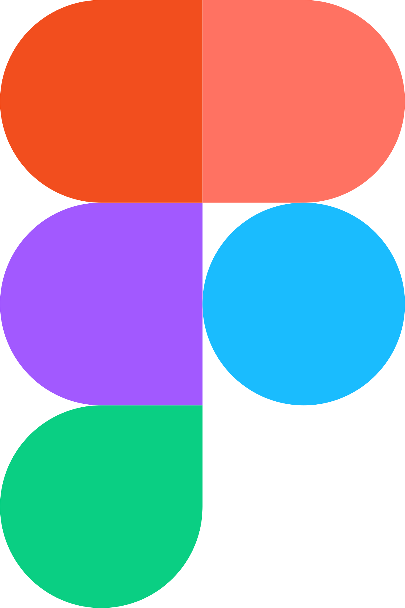
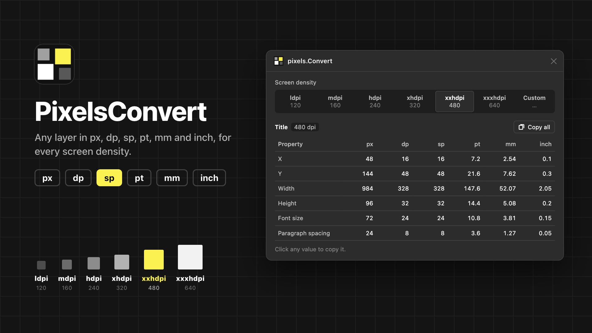
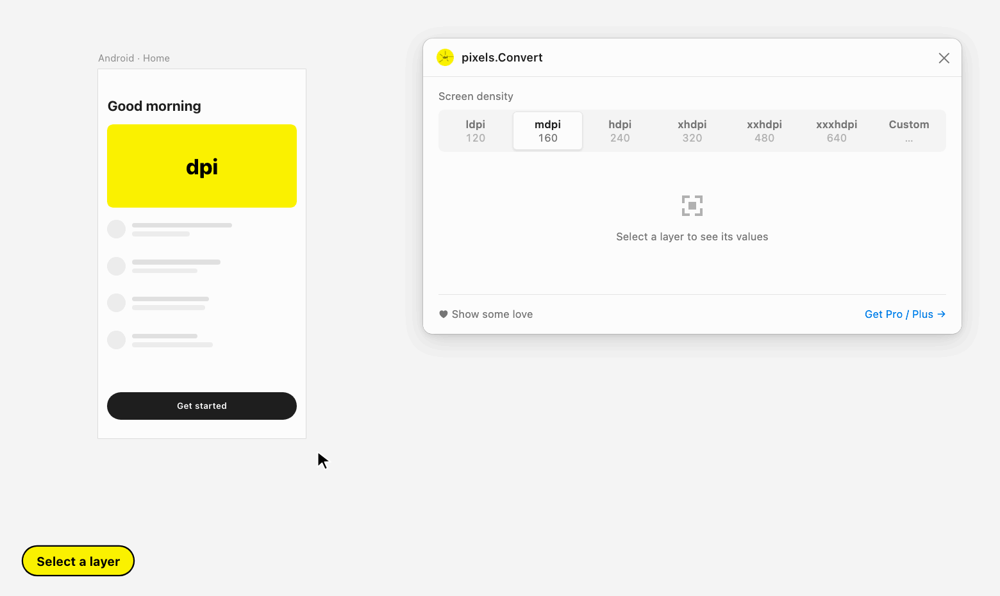

## Pixels Convert 

## [Install Plugin on figma](https://www.figma.com/community/plugin/870191885836440905/PixelsConvert)

A figma plugin to get any layer's position, size, font size and paragraph spacing in px, dp, sp, pt, mm and inch for different screen densities!

- Pick a density: ldpi, mdpi, hdpi, xhdpi, xxhdpi, xxxhdpi, or enter a custom dpi
- Click any value to copy it, or copy the whole table
- Select several layers to get their combined bounds
- Works in Figma's light and dark themes

## Short Preview

## Suggestions?
Found anything absurd? Raise an issue [here!](https://github.com/roshnidesigns/PixelsConvert/issues). Will be grateful for your help =]
